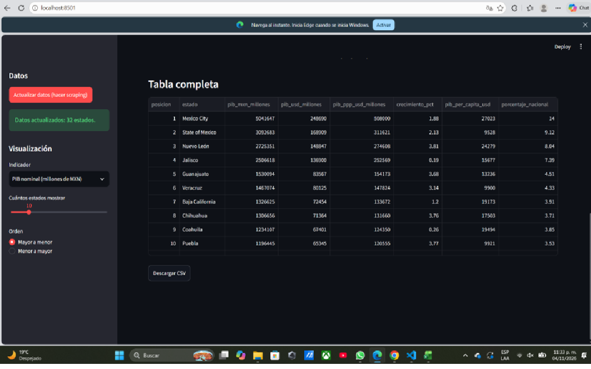
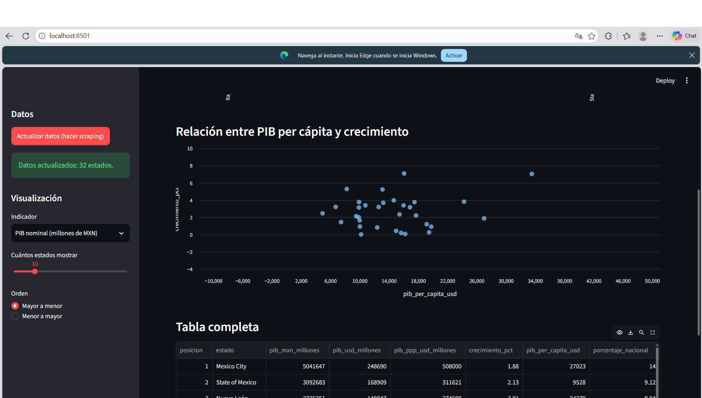
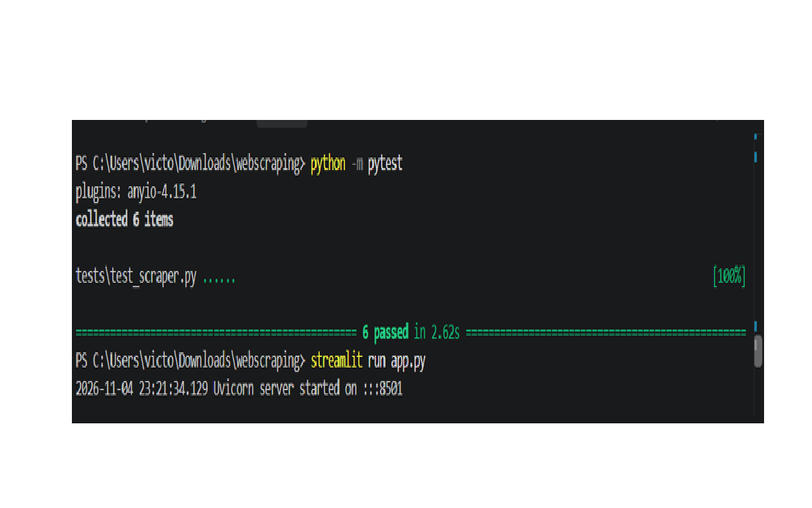

# Web Scraping de Información Económica y Visualización con Streamlit

## 1. Resumen
Este proyecto presenta una solución integral para la extracción automatizada, procesamiento y visualización interactiva de indicadores económicos clave de México. Utilizando bibliotecas de Python como `requests`, `BeautifulSoup` y `pandas`, el sistema recopila información financiera  directamente desde una tabla fija del ano 2022 (wikipedia). Los datos extraídos son procesados y presentados en un dashboard interactivo desarrollado con `Streamlit`. La arquitectura modular del repositorio asegura un flujo colaborativo y controlado mediante Git/GitHub, permitiendo la reproducibilidad del entorno de análisis.

# 2. Introducción

# 2.1. Problema
El acceso a consulta del PIB de nuestro país suele estar disperso en distintas plataformas o en formatos poco amigables para el análisis inmediato. Los usuarios enfrentan dificultades para consultar rápidamente el PIB del país sin realizar búsquedas manuales repetitivas o lidiar con sitios cargados de interfaces complejas.

# 2.2. Objetivos

* Objetivo General: Desarrollar un proceso automatizado de *web scraping* de información económica y presentar sus resultados mediante una interfaz web interactiva con Streamlit, respetando los términos de uso y restricciones técnicas del sitio consultado.
* Objetivos Particulares:
  1. Diseñar un script de extracción que consulte el PIB de cada Estado de México .
  2. Limpiar, estructurar y transformar la información no estructurada extraída del HTML en DataFrames utilizables.
  3. Desplegar un dashboard interactivo con Streamlit para la visualización del PIB en los 32 estados de nuestra república y filtros de consulta.
  4. Nuestro producto básicamente hace filtrado de información y gráfica de esta misma, donde podemos consultar el PIB de cada uno de los estados de México .

# 3. Solución y Evidencia

# 3.1. Arquitectura del Proyecto y Distribución del Trabajo
Para garantizar un desarrollo ordenado y modular, el código se distribuyó en los siguientes archivos principales:
**scraper.py** Responsable: Victor Gonzalez
Contiene la lógica de extracción. descargar_html() hace una sola petición HTTP con User-Agent y timeout; extraer_tabla_pib() recorre las tablas del HTML y encuentra la correcta (la que tiene columnas de estado y PIB en MXN, descartando la de áreas metropolitanas); limpiar_numero() convierte textos como $27,023, +1.88% o 5,041,647[1] en números; validar() comprueba que salgan al menos 30 estados, que todos tengan nombre y que no falte el PIB en pesos.
**app.py** Responsable: Maria Smith
Interfaz en Streamlit. El usuario ve el título, la fuente citada y tres métricas (número de estados, máximo del indicador y promedio). Puede actualizar los datos (botón de scraping), elegir el indicador, cuántos estados mostrar, el orden (mayor/menor), ver una gráfica de barras, un diagrama de dispersión PIB per cápita vs. crecimiento, la tabla completa y descargar el CSV.
**tests/test_scraper.py** Responsable: Emiliano Cervera
Comprueba que limpiar_numero() interpreta los formatos comunes y devuelve None cuando no hay número; que extraer_tabla_pib() elige la tabla correcta y omite los totales; que los valores quedan bien limpios; que se lanza ValueError si no hay tabla o si validar() recibe una tabla incompleta. Usa HTML de ejemplo en lugar de internet para que las pruebas sean rápidas.
**data/pib_estados.csv**Responsable: Emiliano Cervera
Almacena localmente los datos ya procesados. Sirve para que la app arranque sin volver a pedir la página y para conservar una instantánea de los datos.
**requirements.txt** Responsable: Emiliano Cervera
Lista las dependencias del proyecto con versiones mínimas: streamlit, requests, beautifulsoup4, pandas y pytest.

# 3.2. decisiones tecnicas
 Wikipedia Es una fuente pública, accesible y con una tabla ya consolidada del PIB por estado. Además, su contenido se publica bajo licencia CC BY-SA 4.0, lo que permite reutilizarloo citando la fuente (la app muestra la liga en la parte superior).

guardar en CSV en vez de descargar cada vez se usa Para no golpear el sitio con peticiones repetidas , para que la app funcione incluso sin internet una vez cargados los datos y para conservar una instantánea verificable de lo que se analizó.

evitar abusar del sitio Se hace una sola petición por ejecución (solo al pulsar el botón de actualizar)

# 3.3. Evidencias

*Demuestra que la interfaz carga el CSV y muestra los indicadores correctamente.*

*Demuestra la visualización interactiva de los datos según el indicador seleccionado y el orden elegido por el usuario.*

*Demuestra que la lógica de extracción, limpieza y validación funciona correctamente sin depender de una conexión a internet.*

**Liga al repositorio:** https://github.com/victoralfonsogonzalezserrano17-bot/webscraping_PIB_Mexico

# 3.3. Evidencias
Los datos corresponden a 2022 y no se actualizan solos: hay que pulsar el botón de scraping para refrescarlos.

El scraper depende de la estructura de la tabla de Wikipedia; si la cambian (nombres de columnas, orden), habría que ajustar _nombre_columna.

Solo se muestra un año, no una serie de tiempo, por lo que no permite análisis de tendencia.

Se probó con una sola fuente (Wikipedia en inglés); no se contrastó con INEGI u otra fuente oficial.

# 4 conclusiones
 El aprendizaje principal fue que la parte difícil del scraping no es descargar la página, sino limpiar y validar los datos: elegir la tabla correcta, descartar totales y manejar formatos como $27,023, +1.88% o el menos unicode. También se aprendió a separar el código en módulos y a escribir pruebas que no dependan de internet.

Script de extracción del PIB por estado: echo en en scraper.py con descargar_html() y extraer_tabla_pib(); evidencia: pruebass test_extrae_la_tabla_correcta_y_omite_totales.

Limpieza y estructuracion en DataFrames: implementado en limpiar_numero() y en la construccion del DataFrame con COLUMNAS; evidencia: test_los_valores_numericos_se_limpian.

Dashboard interactivo: implementado en app.py con selector de indicador, slider, orden, barras y dispersión; evidencia: capturas de la app.

Descarga de datos: implementado con st.download_button en app.py; evidencia: descarga del CSV.

# 5 reproducibilidad
Para probar este proyecto desde cero, sigue estos pasos. 

**Requisitos previos:**
* Tener instalado Python (se probó con la versión 3.14).
* Tener Git instalado (opcional, si descargas el proyecto como archivo ZIP).
* Conexión a internet (solo necesaria la primera vez para hacer el scraping).

**Paso a paso:**

1. **Obtener el proyecto:** Clona este repositorio o descarga el código y descomprímelo en una carpeta.
 git clone <https://github.com/victoralfonsogonzalezserrano17-bot/webscraping_PIB_Mexico>
cd <webcraping>
Crear y activar un entorno virtual (muy recomendado para no mezclar las librerías con las de tu computadora):

En Windows:
python -m venv .venv
.venv\Scripts\activate

En Mac o Linux:
python3 -m venv .venv
source .venv/bin/activate

Instalar las dependencias: Instala las librerías necesarias (streamlit, pandas, requests, beautifulsoup4, pytest).

pip install -r requirements.txt
Ejecutar la aplicación:

streamlit run app.py
Primeros pasos en la app:
Se abrirá una pestaña en tu navegador web. La primera vez, es posible que veas un aviso indicando que no hay datos. Ve a la barra lateral izquierda y pulsa el botón azul "Actualizar datos (hacer scraping)".

¿Qué deberías ver si todo salió bien?

Un mensaje verde que dice: "Datos actualizados: 32 estados".

Tres tarjetas arriba con el número de estados, el valor máximo y el promedio.

La gráfica de barras interactiva, el gráfico de dispersión y la tabla completa.

El botón de "Descargar CSV" funcionando al final de la página.

(Opcional) Si quieres comprobar que la lógica de extracción está bien programada, puedes correr las pruebas automatizadas en tu terminal:

pytest
Deberías ver un mensaje indicando que todas las pruebas pasaron (ej. 6 passed).
